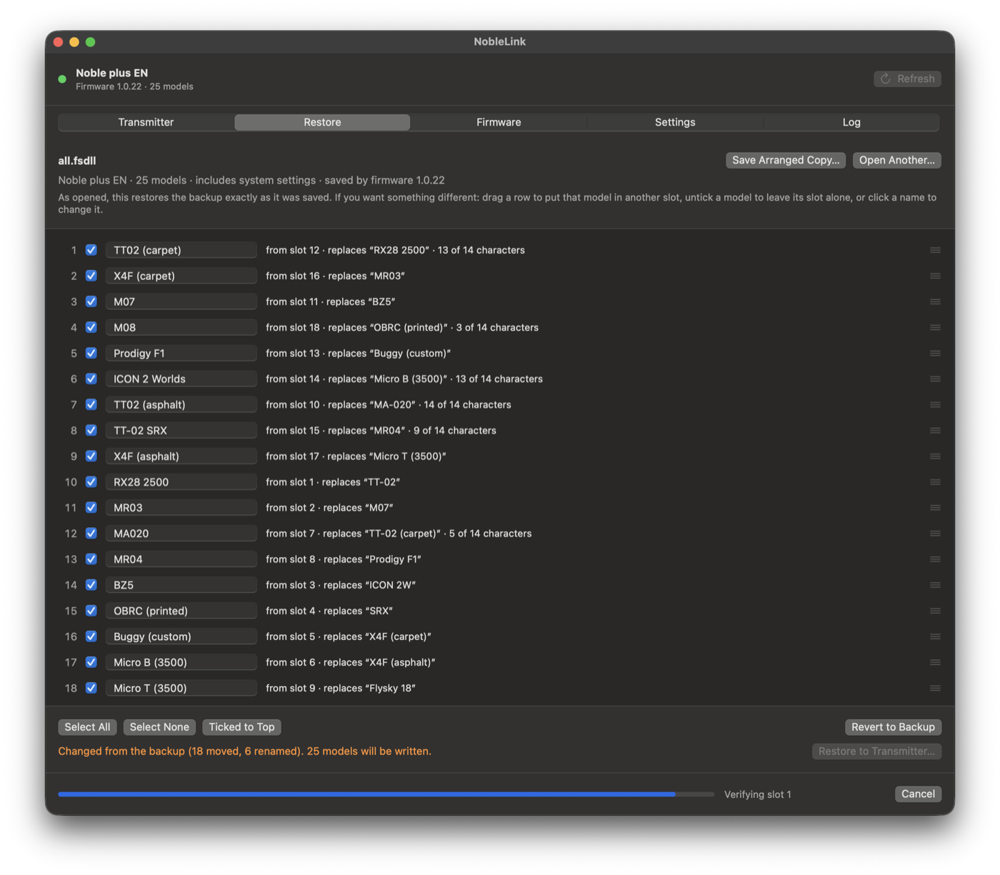

# NobleLink

A Mac app (and command-line tool) for the **FlySky Noble NB4+** transmitter: back up your models,
edit and rearrange them, restore them, and install firmware updates – without FlySky Assistant.



> **Vibe coded, human tested.** The protocol was reverse-engineered and the code written by an AI
> (Claude), working with a human who tested it on a real Noble NB4+ (EN, FCC build): backup,
> restore with moved and renamed models, and a firmware update from 1.0.22 to 1.0.31. Factory reset
> and the in-app installer have so far only run against the built-in simulators. Not affiliated with
> FlySky; use at your own risk – but it is careful (see *Safety*).

## Why

FlySky's official FlySky Assistant felt more like a virus than a tool: it ships with FlySky's own
server passwords in plain text, talks to servers you never asked it to, wants you to log in, and
did not work reliably – on a current Mac, not at all. All we wanted was to save and restore models.

## What it does

| | NobleLink | FlySky Assistant |
|---|:---:|:---:|
| Back up all or some models (FlySky's own `.fsdll` format, files are interchangeable) | ✓ | ✓ |
| Restore models | ✓ | ✓ |
| **Restore into any slot, in any order** (drag to rearrange) | ✓ | – |
| **Rename models offline**, before restoring – no typing on the transmitter | ✓ | – |
| Skip slots that already hold the same model | ✓ | – |
| Reset models to factory defaults | ✓ | – |
| Compare two backups setting by setting (`noble diff`) | ✓ | – |
| Automatic safety copy before every write, and read-back verification after | ✓ | – |
| Check for firmware updates (FlySky's website *and* its older catalogue) and download | ✓ | partly |
| Install firmware, with a no-changes rehearsal first | ✓ | ✓ |
| Runs natively on Apple-silicon Macs, no account, no network unless you ask | ✓ | – |

## Get it running

Needs macOS 13+ and Xcode or just the Command Line Tools (`xcode-select --install`).

```sh
git clone https://github.com/trelaf/NobleLink.git
cd NobleLink/NobleLink
./scripts/build_app.sh        # → dist/NobleLink.app and dist/noble
open dist/NobleLink.app
```

Connect the transmitter with a USB data cable, switch it on, and keep the receiver (car) switched
off – the transmitter refuses model transfers while a receiver is linked.

- **Transmitter** tab – model list, *Back Up Everything…*, *Back Up Selected…*, *Reset…*
- **Restore** tab – open a backup; as opened it restores everything exactly as saved. Drag, untick or
  rename to change that.
- **Firmware** tab – *Check for Updates*, *Download*, then *Rehearse* or *Install…* and follow the
  steps. Pick the same build (FCC or STD) as the transmitter's About screen shows.

The `noble` command does all of the same (`noble help`).

## Safety

- Every restore, reset or firmware install first saves a full copy of the transmitter to
  `~/Library/Application Support/NobleLink/SafetyBackups/`.
- Backups are checked record by record (every setting has a checksum); a damaged file is never
  written. Restored models are read back and compared.
- Backups from different firmware are refused: updates renumber settings, so values would land in
  the wrong place. Make a fresh backup after each firmware update.
- A firmware install compares first, asks before erasing, and verifies both images by checksum. The
  bootloader is never touched, so an interrupted update can simply be run again.

## Supported transmitters

Tested: **Noble NB4+ (Noble plus EN)**, firmware 1.0.22 and 1.0.31. The other Noble/NB4 variants use
the same protocol and are recognised, but have not been tried.

## Contributing / for AI agents

Start with [`CLAUDE.md`](CLAUDE.md) (how the code is organised, how to test without hardware, and
the rules that keep a transmitter safe) and [`docs/PROTOCOL.md`](docs/PROTOCOL.md) (the USB
protocol, file format and firmware update, with the evidence for each claim).

## License

GPL-3.0 – see [LICENSE](LICENSE). You may use, change and share NobleLink; shared modified versions
must also be open source under the GPL. FlySky and Noble are trademarks of their owners.
